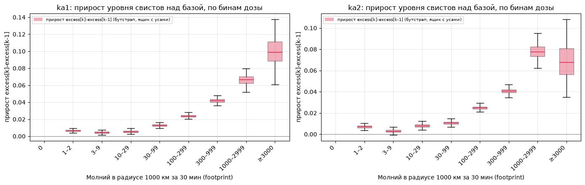

# Свисты и молнии WWLLN

Связь вистлеров на спутниках ka1, ka2 и ka4 с разрядами WWLLN. В файлах предсказаний `verdict = 1` — на этой секунде свист отмечен. Молния — строка AE-файла WWLLN (время, широта, долгота, энергия ОНЧ 5–18 кГц).

Ноутбуки уже содержат посчитанные таблицы и рисунки. На GitHub их видно без запуска. Полный пересчёт занимает от десятков минут до часа на блок и **заменяет** сохранённые выводы. Окна суток в разных ноутбуках не совпадают: сводка ассоциации — разреженные дни 2025 года, доза — 255 суток 20.01–31.10.2025, footprint-ноутбук — прогоны на 347–366 сутках сетки внутри 2025 года. Точные числа печатает ячейка загрузки каждого ноутбука.

## Порядок исследований

Ноутбуки идут в порядке, в котором велось исследование: каждый следующий отвечает на вопрос, оставшийся после предыдущего. Числа ниже — из сохранённых выводов; «рост» — отношение доли свистов к опорной группе, в скобках 95% интервал блочного бутстрапа по суткам.

### 1. `wwlln_reader.ipynb` — разведка

**Вопрос.** Где и когда молнии, где по орбите свисты и связаны ли они.

- **Климатология молний** за 2025 год: карты плотности и покрытия, суточный ход по сезонам, месяцы и широтные пояса, диаграммы Ховмёллера (широта и долгота × местный час), медиана энергии в тех же разрезах.
- **Свисты ka1, ka2, ka4**: экспозиция, сырое число и доля `verdict=1` по местному времени, на карте и на Ховмёллере. Сравнивается доля: сырое число повторяет, где спутник дольше летал.
- **Форма кривых**: доля свистов и плотность молний вдоль широты и долготы, каждая к своему максимуму, ночь и день отдельно.
- **Секундный тест** («этот разряд → этот свист», 21 сутки): разряд в радиусе R до свиста встречается не чаще, чем после (отношение около 0.84, excess ниже нуля на всех радиусах). Связи на масштабе пролёта сигнала не видно.
- **Статистическая ассоциация** (минуты–часы, 21 сутки на аппарат, ka4 — 10 суток августа): `lift` — во сколько раз доля свистов выше, если в радиусе R за последние Δt была молния. В опорной клетке 1000 км / 30 мин: ka1 3.32, ka2 3.20. Event study (±30 мин вокруг скачка вероятности свиста) и сезонный контроль (4 окна года × 2 полушария) идут в том же разделе.
- **Доза–эффект** в последнем разделе — первая версия того, что дальше вынесено в отдельные ноутбуки.

### 2. `stat_assoc_summary.ipynb` — сводка ассоциации

**Вывод.** Если за последние минуты рядом с подспутниковой точкой была молния, доля свистов в 2.5–3.4 раза выше. Эффект есть у ka1, ka2 и ka4, днём и ночью, у ka1 и ka2 — во всех сезонах и полушариях. Ноутбук описывает дизайн теста (сэмпл, надир, ночь по SZA > 98°, выбор опорных клеток R × Δt), отвечает на вопросы к нему и сводит таблицы. Рисунки — в `stat_assoc_figs/`.

**Ограничение.** Это корреляция: ночь, тропики и суша поднимают и молнии, и свисты, а контроль «нет молний в R» при больших R уезжает в приполярье и пустой океан. Отсюда переход к дозе внутри страт.

### 3. `wwlln_reader_shape.ipynb` — форма кривых на большой выборке

**Вопрос.** Повторяет ли форма доли свистов форму молний, если усреднить за 255 суток по сетке сезон × полушарие.

- Широта и долгота, ночь и день, ka1 и ka2, затем ka4.
- Что стоит за одной точкой широтного графика: почасовой ход в четырёх квадратах 2° × 2° за март и разрез по долготе в одной широтной полосе за конкретные сутки. Видно, что спутник проходит квадрат отдельными часами, а молнии в нём идут круглые сутки.
- Доза у магнитного следа (footprint, 1500 км, 120 с) и число молний в бине без радиуса — в тех же разрезах.

**Вывод.** На суммах за длинный период устойчивой общей формы, которую можно сравнивать, нет. Следующий шаг — отдельные пролёты.

### 4. `wwlln_orbit_profiles.ipynb` — одна полуорбита

**Вопрос.** Как доля свистов и число молний меняются вдоль одного пролёта.

- Трек ka1 за 30 суток с 20.01.2025 режется на полуорбиты (753 штуки), на каждой 30 шагов от полюса к полюсу: доля `verdict=1` в окне 60 с и число молний в радиусе 1000 км за 500 с до шага.
- Наложение профилей над Карибами и Океанией, ночь и день, восходящие и нисходящие; в заголовке — корреляция средних профилей свистов и молний.
- Три соседние полуорбиты с полосой суша / вода и картой трассы.
- Пары ka1–ka2: ka2 летит в той же плоскости на 50 мин раньше и в 1067 км от ka1. Примеры над Тихим океаном, Карибами и Африкой, затем все 1350 пар.

**Вывод.** Профили доли свистов у пары ka1–ka2 похожи по форме: медиана по парам r = 0.76 (Спирмен 0.80). Свисты вдоль трассы воспроизводятся двумя аппаратами. Рисунки трассы — в `orbit_profile_plots.py`.

### 5. `wwlln_reader_dose.ipynb` — доза внутри страт

**Вопрос.** Растёт ли доля свистов с числом молний рядом при тех же широте, местном времени (или долготе), сезоне и ночи. Доза — молнии в радиусе 1000 км за 30 мин, сетка 5 мин × 2° × 2°, 255 суток. Сравнение с бином «доза = 0» внутри страт (Мантель–Хензель) и с null-моделью.

**Null-модель.** Свисты остаются сегодняшними, а доза для той же ячейки сетки (место и время суток) берётся из других суток: за 3, 7 и 14 дней раньше, в симметричном варианте ещё и позже. Связи с сегодняшней грозой у такой дозы нет, но климатология места в ней та же: где грозы часты, там и чужая доза высокая. Поэтому рост на null показывает, сколько даёт само место, а отношение «рост на настоящей дозе / рост на null» — «сверх null» — сколько добавляет именно сегодняшняя гроза. Лаг, попавший в другой сезон, пропускается (`null_season_safe`).

- **От местного времени к долготе** (§4.4). Первая схема страт — широта 15° × местное время 3 ч × сезон × ночь (`strata_scheme="lst"`). Местное время держит суточный ход, но география — суша и океан, Южно-Атлантическая аномалия, регион внутри одного широтного пояса — в него почти не входит. День и ночь уже разделяет ось ночи по зенитному углу Солнца, поэтому местное время заменено долготой 45°: широта × долгота × сезон × ночь (`"lon"`), число страт того же порядка. Все дальнейшие проверки и footprint-ноутбук идут на схеме «долгота».
- **День и ночь** (схема «долгота»): днём сверх null 2.48 и 2.32, ночью 1.23 и 1.10.
- **Устойчивость**: радиусы 500–2000 км × окна 15–60 мин дают 1.13–1.70, интервал выше 1 везде, кроме ka1 на 2000 км / 15 мин. От порога ночи (SZA 90–108°) результат почти не зависит.
- **Энергия при той же дозе**: среднюю тянут редкие сильные разряды, поэтому взята медиана (терцили 0.6 и 1.9 кДж). Более энергичные молнии поднимают долю свистов на 8–45% на бинах дозы 3–2999.
- **Проверки носителя**: сколько страт и секунд за каждой точкой, концентрация веса по осям (бин «≥3000» держится на нескольких долготных полосах), ka4 отдельно на 10 сутках.
- **Footprint и сопряжённая точка** (§4.5, §4.8). Молнии ищутся вокруг следа силовой линии спутника на высоте 100 км (footprint, AACGM-v2) или вокруг магнитно-сопряжённой точки в другом полушарии. С footprint результат почти тот же, что под спутником; с сопряжённой точкой интервал «сверх null» накрывает 1 — эффекта нет. Страты и ночь при этом остаются у точки под спутником.

**Остался вопрос.** Доза бралась у footprint, а страты — у точки под спутником. У экватора между ними 900–1200 км.

### 6. `wwlln_reader_dose_rt_footprint.ipynb` — одна геометрия (последние результаты)

**Вопрос.** Держится ли эффект, если страты, ночь и доза считаются в одной точке — footprint (`strata_by_geometry=True`). Null снят, всё — относительно бина «доза = 0»; сетка 1 мин × 2° × 2°, страты 12 × 12, весь 2025 год. Как воспроизвести — раздел «Воспроизведение последних результатов» ниже.

- **Baseline**: рост на «≥3000» ka1 2.86 (2.55–3.24), ka2 2.63 (2.37–3.00); прирост между соседними бинами, абсолютный уровень, forest plot против дозы 0.
- **Почему ka1 и ka2 расходятся на «≥3000»**: регион у обоих один (15…30° широты, −120…−90° долготы), и в этой ячейке сырые доли совпадают (0.46 и 0.48). Расхождение — шум тонкого хвоста.
- **Карты покрытия и дыра AACGM**: у экватора footprint с 827 км не отображается в часть клеток, это структурный ноль.
- **Ночь, день, сезоны, месяцы внутри локального сезона** — рост и абсолютный уровень, с анимациями.
- **Медиана энергии у footprint**: на бинах дозы 10–2999 более энергичные молнии поднимают долю свистов на 16–65%, интервал исключает 1 везде.
- **Почему энергия ночью выше**: по самим молниям WWLLN ночь/день над сушей 1.98, над океаном 1.75. Подъём есть над обоими типами поверхности, это ближе к приборному объяснению (затухание сигнала в волноводе).
- **Радиус и окно**: 10 пар — радиусы 500–3000 км при Δt = 30 мин и окна 2–60 мин при R = 1000 км. Пороги дозы те же, что для 30 мин, без растяжения на Δt/30. Рисунок P(сегмент) − P(доза = 0) и бинарный срез «≥1 молния» против нуля. Рост отношения к P(доза = 0) на больших радиусах был артефактом падения самой базовой доли.
- **Камчатка**: рамка полуострова внутри грубой страты и сырое сравнение с остальной полосой той же широты.


## Как развернуть

```bash
python3.12 -m venv .venv
source .venv/bin/activate
pip install -r requirements.txt
cp .env.example .env
```

В `.env` — `WWLLN_USER` и `WWLLN_PASS`: нужен свой действующий логин WWLLN. Файл не коммитится.

```bash
python data_download.py
```

Скрипт складывает выгрузку в `WWLLN/` рядом с собой: для расчётов нужны `WWLLN/AEfiles/` (энергия разряда, 13 ГБ за 2025 год). Скрипт качает и `WWLLN/Afiles/` (3.8 ГБ) — анализу они не нужны, их можно удалить. Повторный запуск пропускает уже скачанные целые файлы.

Место на диске: AE 13 ГБ, предсказания 8 ГБ, кэш молний 5.7 ГБ — около 30 ГБ.

Предсказания свистов скрипт не качает. Их кладут вручную, нужна только папка `whistler_binary`:

```text
predictions/whistler_binary/ka1/predictions_ka1_fl_YYMMDD000000_YYMMDD000000.csv
predictions/whistler_binary/ka2/...
predictions/whistler_binary/ka4/...
```

Колонки: `timestamp`, `geo_lat`, `geo_lon`, `is_night`, `solar_zenith_angle`, `prob_whistle`, `verdict`. Время в файле — МСК; `wwlln_common.read_pred_file` вычитает 3 часа. Имя файла разбирает `pred_day_key_from_name`: сутки — `20` + первые шесть цифр после `_fl_`.

**Ноутбуки, читающие данные, берут пути из** `wwlln_common.resolve_paths()`**: AE —** `WWLLN/AEfiles`**, предсказания —** `predictions/whistler_binary`**, кэш parquet —** `cache/`**. Корень — текущая папка (из** `WWLLN/` **функция поднимается на уровень выше); другой корень передаётся аргументом:** `wc.resolve_paths("/data/wwlln")`**. Если данные лежат в другой раскладке, правят словарь в этой функции.**

Ноутбуки открываются в Cursor или VS Code с ядром из `.venv`; для браузерного Jupyter — `pip install jupyterlab`. Ячейки идут сверху вниз: после рестарта ядра снова нужна ячейка загрузки. Карты (`cartopy`) при первом запуске докачивают береговую линию Natural Earth. После правки модуля при открытом ноутбуке нужен `importlib.reload(dp)` (так же `wc`, `mag_coords`) или перезапуск ядра; ячейка загрузки footprint-ноутбука делает reload сама.

### Кэш молний и память

Модули читают молнии из `cache/AE_20250101_20251231.parquet`, если он есть, и дочитывают из `.loc.gz` сутки, которых в нём нет. Папка `cache/` в git не входит, поэтому после клонирования кэша нет. Без него всё работает, но каждая загрузка заново читает `.loc.gz`; с кэшем загрузка года занимает меньше минуты.

Кэш собирается сам: если файла нет, первый вызов `wc.ensure_data` в любом ноутбуке создаёт его за весь 2025 год (около 4 мин, пик 3.5 ГБ памяти), дальше все ноутбуки читают его. `build_cache=False` отключает сборку — тогда читаются только нужные `.loc.gz`. Отдельно кэш собирает `wc.build_ae_cache(paths["ae"], paths["cache"] / wc.AE_CACHE_NAME, "20250101", "20251231")`; такой же файл пишут ячейки 4–5 `wwlln_reader.ipynb`.

Год молний — 254 млн разрядов: около 5 ГБ в памяти и 5.7 ГБ кэша на диске. Сверху — предсказания и накопители; медиана энергии держит ещё около 570 МБ. Для полного года стоит рассчитывать на 16 ГБ памяти и больше; на меньшей — сокращать период через `DOSE_MAX_DAYS` или фильтр дат.

## Воспроизведение последних результатов

Последние результаты — `wwlln_reader_dose_rt_footprint.ipynb`: страты, ночь и доза в точке footprint, рост относительно бина «доза = 0». Null-модель решено не использовать, везде `null_lags=()`. Ноутбук можно прогнать сверху вниз (сохранённые выводы перезапишутся) или собрать те же шаги в новом ноутбуке из корня проекта, как ниже.


| Шаг                                    | Раздел ноутбука                          | Время сохранённого прогона          |
| -------------------------------------- | ---------------------------------------- | ----------------------------------- |
| Загрузка                               | «1. Загрузка»                            | 1.5 мин с готовым `cache/*.parquet` |
| Baseline R = 1000 км, Δt = 30 мин      | «2. Baseline…»                           | 17 мин                              |
| Медиана энергии при фиксированной дозе | «Энергия молний при фиксированной дозе…» | 37 мин                              |
| Радиус и окно, 10 пар                  | «Sweep по R и Δt»                        | 1 ч 3 мин                           |


Baseline, энергия и sweep не зависят друг от друга: каждому нужна только загрузка.

В самом ноутбуке настройки прогона собраны в переменных ячейки 2 («1. Загрузка»): чтобы пересчитать с другими параметрами, меняют их там и перезапускают ячейки ниже. Подробнее о каждом аргументе — в таблицах разделов 2 и 3.

| Переменная ноутбука | Значение | Что задаёт | Аргумент функции |
|---|---|---|---|
| `DOSE_SC` | `("ka1", "ka2")` | Аппараты | `sc_list` всех накопителей |
| `DOSE_MAX_DAYS` | `None` | Число суток для пробного прогона; `None` — все | Обрезка списка суток |
| `DOSE_R_KM`, `DOSE_DT_MIN` | 1000, 30 | Доза: молнии в радиусе R км за последние Δt мин | `dose_r_km`, `dose_dt_min` |
| `GLAT`, `GLON`, `GDT_MIN` | 2, 2, 1 | Шаг сетки: градусы широты и долготы, минуты | `glat`, `glon`, `gdt_min` (у медианы энергии `gdt_min=5` задан в её ячейке) |
| `STRATA_SCHEME`, `N_LATB`, `N_LONB` | `"lon"`, 12, 12 | Страты: широта × долгота × сезон × ночь, число полос широты и долготы | `strata_scheme`, `n_latb`, `n_lonb` |
| `NULL_LAGS`, `NULL_SYMMETRIC`, `NULL_SEASON_SAFE` | `()`, `False`, `True` | Null-модель (доза из других суток); `()` — выключена | `null_lags`, `null_symmetric`, `null_season_safe` |
| `NIGHT_SZA_DEG`, `SAT_HEIGHT_KM` | 98, 827 | Порог ночи (зенитный угол Солнца, °) и высота спутника для footprint, км | `night_sza_deg`, `sat_height_km` |
| `DOSE_EDGES`, `DOSE_LABELS` | `dp.DEFAULT_DOSE_*` | Границы бинов дозы и их подписи | `dose_edges` и подписи на рисунках |
| `MIN_STRAT_EXP` | 300 | Минимум секунд страты в каждом из двух сравниваемых бинов, чтобы она вошла в сравнение | `min_strat_exp` в `analyze` / `analyze_energy_lon` |
| `MIN_REPORT_EXP` | 15000 | Минимум секунд в бине, чтобы он стал отчётным | `min_exp` в `report_bin` |
| `N_BOOT`, `REF_BIN` | 200, 0 | Число повторов бутстрапа и опорный бин дозы | `n_boot`, `ref_bin` |

Параметры отдельных блоков заданы в их ячейках: `SHOW_BIN_3000` в ячейках рисунков, `E_EDGES_TERTILE` в ячейке медианы энергии (46), `R_LIST` / `DT_LIST` в ячейке 57.

### 1. Загрузка

```python
import numpy as np
import wwlln_common as wc
import dose_pipeline as dp

SC = ("ka1", "ka2")
DOSE_MAX_DAYS = None   # число — первые N суток (пробный прогон), None — все
paths = wc.resolve_paths()
days = wc.analysis_days(paths["pred"], paths["ae"], SC, require_all_sc=False)
# days = [d for d in days if "20250401" <= d <= "20250630"]   # или конкретный период
if DOSE_MAX_DAYS is not None:
    days = days[:DOSE_MAX_DAYS]
codes = wc.day_codes(days)
ae_days = [str(np.datetime64(int(c), "D")).replace("-", "")
           for c in range(int(codes.min()) - 1, int(codes.max()) + 1)]
df, df_pred = wc.ensure_data(globals(), days=days, ae_days=ae_days)   # первый раз собирает кэш молний
acc_days = sorted(int(c) for c in codes)
```

- `wc.analysis_days(pred_dir, ae_dir, sc_list=("ka1", "ka2"), require_all_sc=True)` — сутки `YYYYMMDD`, где есть AE и предсказания. `require_all_sc=False` берёт сутки, если есть хотя бы один аппарат (так в footprint-ноутбуке); `True` — только общие сутки. Период задаётся обрезкой этого списка до `ensure_data`: `DOSE_MAX_DAYS` (так же в ячейке 2 ноутбука) или фильтр по датам.
- `wc.ensure_data(env, days=None, ae_days=None, need_ae=True, need_pred=True, build_cache=True, verbose=True)` — кладёт в `env` таблицы `df` (молнии: `datetime`, `lat`, `lon`, `energy`) и `df_pred` (предсказания, время UTC). Уже загруженные таблицы не перечитывает: для другого набора суток сначала `del df, df_pred`. Молнии берутся из `cache/AE_20250101_20251231.parquet`, недостающие сутки — из `.loc.gz`.
- `ae_days` начинаются на сутки раньше периода: окно дозы у полуночи первого дня заходит в предыдущие сутки.
- `acc_days` — номера суток (дни от 1970-01-01), их ждут функции `dose_pipeline`.


### 2. Baseline: `dp.run_accumulation`

```python
accum = dp.run_accumulation(
    df, df_pred, sc_list=SC, acc_days=acc_days,
    dose_r_km=1000.0, dose_dt_min=30, glat=2.0, glon=2.0, gdt_min=1,
    null_lags=(), do_energy=False,
    strata_scheme="lon", n_latb=12, n_lonb=12,
    geometry="footprint", sat_height_km=827.0, strata_by_geometry=True,
    dose_edges=dp.DEFAULT_DOSE_EDGES,
)
```


| Аргумент                              | В ноутбуке                                   | Что задаёт                                                                                                                                         |
| ------------------------------------- | -------------------------------------------- | -------------------------------------------------------------------------------------------------------------------------------------------------- |
| `sc_list`                             | `("ka1", "ka2")`                             | Аппараты; позиция в кортеже — это `sc` в `analyze`                                                                                                 |
| `acc_days`                            | все сутки загрузки                           | Сутки, по которым копится статистика                                                                                                               |
| `dose_r_km`                           | 1000                                         | Радиус дозы: окрестность ±R по широте и долготе в ячейках сетки                                                                                    |
| `dose_dt_min`                         | 30                                           | Окно дозы: молнии за Δt минут до наблюдения, включая текущую минуту                                                                                |
| `glat`, `glon`                        | 2.0, 2.0                                     | Шаг сетки молний и спутника, градусы                                                                                                               |
| `gdt_min`                             | 1                                            | Шаг сетки по времени, мин. Δt должно делиться на него; 1 мин нужна для Δt = 2 и 5 в sweep, по умолчанию 5                                          |
| `null_lags`                           | `()`                                         | Пусто — null выключен. `(3, 7, 14)` — доза из суток на 3, 7, 14 дней раньше, тогда `ae_days` нужно начинать на `max(lags) + 1` суток раньше        |
| `null_symmetric`, `null_season_safe`  | `False`, `True`                              | Лаги ещё и вперёд; пропуск лага из другого сезона. Работают только при включённом null                                                             |
| `do_energy`                           | `False`                                      | `True` добавляет ось средней энергии молний в окрестности (`exp_en_d`, `pos_en_d`) по границам `e_edges`                                           |
| `night_sza_deg`                       | 98                                           | Ночь — зенитный угол Солнца больше порога на поверхности; `None` = 98                                                                              |
| `strata_scheme`                       | `"lon"`                                      | `"lon"`: широта × долгота × сезон × ночь. `"lst"`: долгота заменяется местным временем                                                             |
| `n_latb`, `n_lonb`, `n_hourb`         | 12, 12, —                                    | Число полос широты, долготы и местного времени (последнее — только для `"lst"`)                                                                    |
| `geometry`                            | `"footprint"`                                | Где ищется доза: `"satellite"` — под спутником, `"footprint"` — след силовой линии на 100 км в том же полушарии, `"conjugate"` — в противоположном |
| `sat_height_km`                       | 827                                          | Высота спутника для трассировки AACGM-v2                                                                                                           |
| `strata_by_geometry`                  | `True`                                       | Страты и ночь считаются в той же точке, что и доза. `False` — страты у точки под спутником                                                         |
| `strata_coords`                       | `"geo"`                                      | `"mag"` — страты в геомагнитных координатах AACGM (только при `strata_by_geometry=True`)                                                           |
| `dose_edges`                          | `[0, 1, 3, 10, 30, 100, 300, 1000, 3000, ∞]` | Границы бинов дозы, подписи — `dp.DEFAULT_DOSE_LABELS`                                                                                             |
| `e_edges`                             | —                                            | Границы энергии для `do_energy=True`                                                                                                               |

Возвращается словарь накопителей. `exp_true_d` — экспозиция (секунды наблюдения), `pos_true_d` — число секунд с `verdict=1`, `prb_true_d` — сумма `prob_whistle`. Оси: сутки × аппарат × широта × долгота (или местное время) × сезон × ночь × бин дозы. `*_null_d` при `null_lags=()` нулевые. Остальные ключи — параметры прогона.

### 3. Кривая и отчётный бин: `dp.analyze`, `dp.report_bin`

```python
res = dp.analyze(accum, sc=0, n_boot=200, ref_bin=0, min_strat_exp=300)
k = dp.report_bin(res, min_exp=15000, min_strata=5, require_null=False)
if k is None:
    print("ни один бин не набрал экспозицию и страты")
else:
    print(dp.DEFAULT_DOSE_LABELS[k], res["rr_t"][k], res["ci_t"][:, k])
```

`analyze(accum, sc=None, night=None, outcome="verdict", n_boot=200, seed=0, ref_bin=0, min_strat_exp=500)`:


| Аргумент         | Что задаёт                                                                                                    |
| ---------------- | ------------------------------------------------------------------------------------------------------------- |
| `sc`             | Индекс аппарата в `sc_list`; `None` — все вместе                                                              |
| `night`          | `None` — день и ночь вместе, `0` — день, `1` — ночь                                                           |
| `outcome`        | `"verdict"` — доля секунд со свистом; любое другое значение — средняя `prob_whistle`                          |
| `n_boot`, `seed` | Повторы блочного бутстрапа по суткам и зерно; результат воспроизводим                                         |
| `ref_bin`        | Опорный бин дозы, обычно 0                                                                                    |
| `min_strat_exp`  | Страта входит в сравнение бина `k` с опорным, если в обоих бинах экспозиция не меньше порога (в ноутбуке 300) |


Результат — словарь массивов длиной в число бинов дозы:


| Ключ                                                     | Что это                                                                                                               |
| -------------------------------------------------------- | --------------------------------------------------------------------------------------------------------------------- |
| `raw`                                                    | Доля `verdict=1` в бине без страт                                                                                     |
| `rr_t`, `ci_t`                                           | Рост Мантеля–Хензеля относительно бина 0 внутри одинаковых страт и его 95%-интервал (`ci_t[0]`, `ci_t[1]`)            |
| `pk_t`, `p0_t`, `ci_pk_t`, `ci_p0_t`                     | Уровень в бине `k` и в опорном бине, посчитанные на стратах, общих для этой пары; `p0_t` поэтому свой для каждого `k` |
| `bpk_t`, `bp0_t`                                         | Те же уровни по каждому повтору бутстрапа, форма (`n_boot`, бины) — для интервалов разностей                          |
| `nst`, `expo`                                            | Число страт в сравнении и экспозиция бина, с                                                                          |
| `rr_n`, `rrr`, `ci_n`, `ci_rrr`, `pk_n`, `p0_n`, `bpk_n` | Null-ветка; при `null_lags=()` — NaN                                                                                  |


`analyze` сам отчётный бин не выбирает. `report_bin(res, min_exp=20000, min_strata=5, ref_bin=0, require_null=True)` возвращает самый верхний бин, где хватает экспозиции и страт, или `None`. По умолчанию он требует конечный `rr_n`, поэтому без null нужен `require_null=False`. В footprint-ноутбуке отчётный бин — «≥3000»: ka1 2.86 (2.55–3.24), ka2 2.63 (2.37–3.00).

### 4. Рисунок прироста

Последний вариант рисунка — ячейка 10 («Тот же прирост, без полосы уровня при дозе 0»). Превышение бина над своей базой `excess[k] = pk_t[k] − p0_t[k]`; ящик — разность `excess[k] − excess[k−1]` по повторам бутстрапа. Ящик выше нуля — переход в следующий бин дозы добавляет свистов.



Сохранённый прогон: 366 суток сетки 2025 года, R = 1000 км, Δt = 30 мин, footprint. Все ящики выше нуля, прирост растёт с дозой; у ka2 бин «≥3000» ниже «1000–2999» и с широким разбросом — экспозиции там мало.

```python
import matplotlib.pyplot as plt
from matplotlib.patches import Patch

SHOW_BIN_3000 = True  # False — не рисовать открытый бин «≥3000»
labels = dp.DEFAULT_DOSE_LABELS[slice(None) if SHOW_BIN_3000 else slice(None, -1)]
n_bins_show = len(labels)

fig, axes = plt.subplots(1, len(SC), figsize=(7 * len(SC), 4.5), squeeze=False)
for si, sc in enumerate(SC):
    r = dp.analyze(accum, sc=si, n_boot=200, ref_bin=0, min_strat_exp=300)
    ax = axes[0, si]
    excess_boot = r["bpk_t"] - r["bp0_t"]
    box_data, box_pos = [], []
    for k in range(1, n_bins_show):
        diff_boot = excess_boot[:, k] - excess_boot[:, k - 1]
        diff_boot = diff_boot[np.isfinite(diff_boot)]
        if diff_boot.size:
            box_data.append(diff_boot)
            box_pos.append(k)
    if box_data:
        bp = ax.boxplot(box_data, positions=box_pos, widths=0.5, patch_artist=True, showfliers=False)
        for patch in bp["boxes"]:
            patch.set_facecolor("crimson")
            patch.set_alpha(0.35)
        for med in bp["medians"]:
            med.set_color("crimson")
    ax.axhline(0, color="black", lw=0.7, alpha=0.5)
    ax.set_xticks(np.arange(n_bins_show))
    ax.set_xticklabels(labels, rotation=45, ha="right")
    ax.set_xlim(-0.5, n_bins_show - 0.5)
    ax.set_xlabel("Молний в радиусе 1000 км за 30 мин (footprint)")
    ax.set_ylabel("прирост excess[k]-excess[k-1]")
    ax.set_title(f"{sc}: прирост уровня свистов над базой, по бинам дозы")
    ax.grid(alpha=0.3)
    ax.legend(handles=[
        Patch(facecolor="crimson", alpha=0.35, label="прирост excess[k]-excess[k-1] (бутстрап, ящик с усами)"),
    ], fontsize=7.5, loc="upper left")
fig.tight_layout()
plt.show()
```

Рядом в ноутбуке: абсолютный уровень `pk_t` (ячейка 12), forest plot `rr_t` с `ci_t` (ячейка 14), ночь и день — тот же `analyze` с `night=0/1`, сезоны — срез накопителя по оси сезона.

### 5. Энергия при той же дозе: `dp.run_median_energy_lon`, `dp.analyze_energy_lon`

```python
accum_e = dp.run_median_energy_lon(
    df, df_pred, sc_list=SC, acc_days=acc_days,
    dose_r_km=1000.0, dose_dt_min=30, glat=2.0, glon=2.0, gdt_min=5,
    strata_scheme="lon", n_latb=12, n_lonb=12,
    dose_edges=dp.DEFAULT_DOSE_EDGES, e_edges=np.array([0.0, 600.0, 1900.0, np.inf]),
    n_hist_bins=16, e_hist_max=4000.0,
    geometry="footprint", sat_height_km=827.0, strata_by_geometry=True,
)
rr, ci, p_k, nst, expo = dp.analyze_energy_lon(accum_e, si=0, db=5, n_boot=200, min_strat_exp=300)
```

Аргументы те же, что у `run_accumulation`, без null и `do_energy`. Свои:


| Аргумент                    | В ноутбуке             | Что задаёт                                                                                                               |
| --------------------------- | ---------------------- | ------------------------------------------------------------------------------------------------------------------------ |
| `e_edges`                   | `[0, 600, 1900, ∞]` Дж | Классы медианной энергии молний в окрестности (терцили)                                                                  |
| `n_hist_bins`, `e_hist_max` | 16, 4000 Дж            | Гистограмма, по которой ищется медиана; точность — `e_hist_max / n_hist_bins`. По умолчанию `e_hist_max` = 8000          |
| `gdt_min`                   | 5                      | Кэш гистограмм на 2 суток — около 570 МБ при 5 мин; на минутной сетке примерно впятеро больше. Окно дозы остаётся 30 мин |


`analyze_energy_lon(accum, si, db, ref_bin=0, n_boot=200, seed=0, min_strat_exp=500)` сравнивает классы энергии внутри одного бина дозы `db` и одинаковых страт. Возвращает кортеж по классам энергии: `rr` — рост относительно класса `ref_bin` (<0.6 кДж), `ci` — 95%-интервал, `p_k` — уровень `verdict=1`, `nst`, `expo`. Рисунок — ячейка 47: по каждому бину дозы `p_k` и `rr` с `ci` против класса энергии.

### 6. Радиус и окно: `dp.sweep_r_dt`

```python
R_LIST = [500.0, 1000.0, 1500.0, 2000.0, 3000.0]
DT_LIST = [2, 5, 10, 15, 30, 60]
pairs = sorted(set([(r, 30) for r in R_LIST] + [(1000.0, dt) for dt in DT_LIST]))
sweep = dp.sweep_r_dt(
    df, df_pred, sc_list=SC, acc_days=acc_days, r_dt_pairs=pairs,
    glat=2.0, glon=2.0, gdt_min=1, null_lags=(),
    strata_scheme="lon", n_latb=12, n_lonb=12,
    geometry="footprint", sat_height_km=827.0, strata_by_geometry=True,
    dose_edges=dp.DEFAULT_DOSE_EDGES,
)
```

Аргументы те же, что у `run_accumulation`, кроме `dose_r_km` / `dose_dt_min` (их заменяет `r_dt_pairs` — список пар `(R, Δt)`), `do_energy` и `strata_coords`. Свои:


| Аргумент             | В ноутбуке | Что задаёт                                                                                     |
| -------------------- | ---------- | ---------------------------------------------------------------------------------------------- |
| `r_dt_pairs`         | 10 пар     | Все R при Δt = 30 и все Δt при R = 1000. Сетки молний и спутника строятся один раз на все пары |
| `dose_edges_base_dt` | не задан   | Если задан, границы дозы умножаются на `Δt / base_dt` (сравнение частоты, а не числа молний)   |
| `dose_edges_base_r`  | не задан   | Если задан, границы ещё умножаются на `(R / base_r)²`                                          |


Результат — словарь `{(R, Δt): накопитель}`, к каждому применим `analyze`. Рисунок — ячейки 59–60: девять бинов склеиваются в четыре сегмента плюс «0», для каждой пары и для дня и ночи считается `pk_t − p0_t` сегмента, тепловая карта «сегмент × R» при Δt = 30 и «сегмент × Δt» при R = 1000. Склейка бинов — сумма накопителей по последней оси:

```python
def merge_dose_bins(accum, groups):
    out = dict(accum)
    for key in ("exp_true_d", "pos_true_d", "prb_true_d", "exp_null_d", "pos_null_d", "prb_null_d"):
        out[key] = np.stack([accum[key][..., g].sum(axis=-1) for g in groups], axis=-1)
    out["n_dose"] = len(groups)
    return out

seg = merge_dose_bins(sweep[(1000.0, 30)], [[0], [1, 2], [3, 4], [5, 6], [7, 8]])
r = dp.analyze(seg, sc=0, night=1, n_boot=30, min_strat_exp=300)
excess = r["pk_t"][1:] - r["p0_t"][1:]
```

Бинарный срез «хотя бы одна молния» против нуля (ячейка 62) — та же склейка с группами `[[0], [1, 2, 3, 4, 5, 6, 7, 8]]`.

### Константы модулей

Меняют поведение всех блоков сразу. Правят в файле модуля и перезапускают ядро: часть из них подставляется в значения по умолчанию при импорте.

| Константа | Значение | Что задаёт |
|---|---|---|
| `wc.NIGHT_SZA_DEG` | 98° | Порог ночи — зенитный угол Солнца на поверхности |
| `wc.PRED_MSK_OFFSET_HOURS` | 3 | Сдвиг времени файлов предсказаний к UTC |
| `wc._SEA_N`, `wc._SEA_S` | DJF зима, MAM весна, JJA лето, SON осень; на юге наоборот | Месяц → сезон по полушариям, подписи — `wc.SEASON_ORDER` |
| `dp.DEFAULT_DOSE_EDGES`, `dp.DEFAULT_DOSE_LABELS` | 0, 1, 3, 10, …, 3000, ∞ | Бины дозы по умолчанию |
| `dp.DEFAULT_E_EDGES`, `dp.DEFAULT_E_LABELS` | 0, 2000, 6000, ∞ Дж | Классы энергии по умолчанию (`do_energy=True`, медиана без `e_edges`) |

### Новые данные и другие аппараты

- **Новый период.** `python data_download.py` докачивает то, чего нет в `WWLLN/` (нужен действующий логин WWLLN). Предсказания кладутся в `predictions/whistler_binary/<аппарат>/`, `analysis_days` подхватывает их сам. Кэш покрывает 2025 год: сутки вне его читаются из `.loc.gz`. Кэш на другой период собирают под новым именем и до `ensure_data` указывают его имя:

  ```python
  wc.AE_CACHE_NAME = "AE_20250101_20261231.parquet"
  wc.build_ae_cache(paths["ae"], paths["cache"] / wc.AE_CACHE_NAME, "20250101", "20261231")
  ```

  `load_ae` читает кэш целиком и затем отбирает сутки, поэтому кэш на два года займёт в памяти около 10 ГБ на время загрузки.
- **ka4 и другие аппараты.** `ensure_data` загружает предсказания только ka1 и ka2. Для другого набора предсказания грузят напрямую: `df_pred = wc.load_predictions(paths["pred"], sc_list=SC, days=days)`. Имя аппарата — подпапка в `predictions/whistler_binary/` и часть имени файла. В `df_pred` должны быть только аппараты из `sc_list` накопителя, иначе `ValueError`; лишние отфильтровывают `df_pred[df_pred["sc"].isin(SC)]`. С `require_all_sc=True` остаются только сутки, общие для всех аппаратов из `SC`.

### Ранние этапы: ассоциация и профили орбит

Статистическая ассоциация из `wwlln_reader.ipynb` (выводы — в `stat_assoc_summary.ipynb`):

```python
import whistler_lightning_assoc as wla

days = wc.spread_days(wc.sc_days(paths["pred"], paths["ae"], "ka1"), 20)
cfg = wla.AssocConfig(
    pred_dir=paths["pred"], ae_dir=paths["ae"], sc_list=("ka1",),
    day_list=days, max_days=None, skip_causal=True,
    event_r_km=1000.0, event_pre_h=0.5, event_post_h=0.5, event_bin_h=1 / 12,
    max_onsets_per_sc_day=200,
)
res = wla.run_association(cfg, sc_filter="ka1")
print(wla.lift_at(res, r_km=1000, dt_min=30))
wla.plot_statistical_suite(res, title_prefix="ka1", mark_cells=((1000, 30),))
```

- `wc.spread_days(days, n)` — n суток равномерно по покрытию; `wc.sc_days` — сутки одного аппарата с AE.
- `AssocConfig` — около 30 полей: сетка R × Δt для lift (`stat_r_km`, `stat_dt_min`), сэмплов на сутки (`max_points_per_day`), секундный тест (`causal_*`, `radius_grid_km`; `causal_only` / `skip_causal`), event study (`event_*`), фильтры (`energy_min`, `lat_range`, `geometry`). Полный список с пояснениями — в его докстринге.
- `run_association(cfg, night_filter=None, sc_filter=None)` — `night_filter=1/0` оставляет ночь или день. Около 25 с на аппарат-сутки при 12 000 сэмплов.
- `lift_at(res, r_km, dt_min)` — lift в заранее выбранной ячейке (максимум по сетке смещён вверх); `plot_statistical_suite` — карты P и lift, P от расстояния и времени, event study; `plot_causal_suite` — секундный тест.

`orbit_profile_plots` рисует профили полуорбит, которые строит `wwlln_orbit_profiles.ipynb`. Профиль — dict массивов по шагам от полюса к полюсу: `t`, `lat`, `lon`, `verdict` (доля свистов), `count` (молний в радиусе). Функции: `plot_adjacent_orbits` — соседние полуорбиты одного направления с картами и таблицей времени; `plot_verdict_pair_with_maps` — профили доли свистов нескольких трасс с картами; `plot_orbit_map`, `add_land_strip`, `steps_over_land` — карта трассы и полоса «суша / вода» под графиком.

### Куда смотреть в коде


| Задача                  | Функция                                                                                                                                                                       |
| ----------------------- | ----------------------------------------------------------------------------------------------------------------------------------------------------------------------------- |
| Ночь и сезон            | `wc.night_mask` (зенитный угол > 98° на поверхности), `wc.season_index` (в южном полушарии зима и лето сдвинуты на полгода)                                                   |
| Дни и загрузка          | `wc.analysis_days`, `wc.ensure_data`, `wc.load_ae`, `wc.load_predictions`                                                                                                     |
| Доза, страты, null      | `dp.run_accumulation`. `geometry`: `satellite`, `footprint`, `conjugate`. `strata_by_geometry=True` переносит страты в ту же точку, что и доза. `null_lags=()` отключает null |
| Кривая и отчётный бин   | `dp.analyze`, `dp.report_bin` (без null — `require_null=False`)                                                                                                               |
| Энергия при той же дозе | `dp.run_median_energy_lon`, затем `dp.analyze_energy_lon`                                                                                                                     |
| Сетка радиус × окно     | `dp.sweep_r_dt`. Без `dose_edges_base_dt` пороги дозы одни и те же для всех окон                                                                                              |
| Footprint               | `mag_coords.footprint_conjugate_arr(lat, lon, h_km, date)` — след на 100 км и сопряжённая точка, AACGM-v2                                                                     |
| Ассоциация минуты–часы  | `whistler_lightning_assoc.AssocConfig` и `run_association`; рисунки — `plot_statistical_suite`                                                                                |


`dp.sweep_night_sza` перебирает порог ночи. Вспомогательные `select_strata`, `mh`, `pooled` обычно вызываются из `analyze`, а не из ноутбука. Аргументы и возвращаемые значения всех функций описаны в их докстрингах (`help(dp.run_accumulation)`); общие аргументы накопителей — в докстринге `dose_pipeline`.